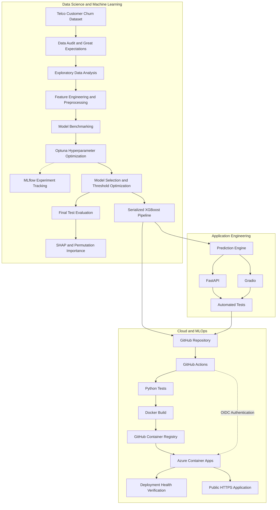
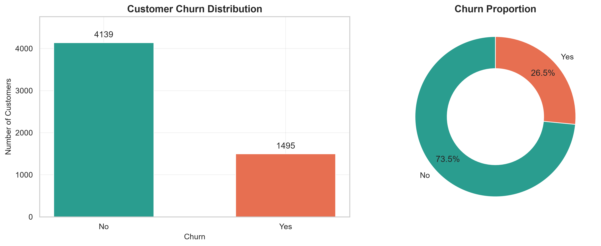
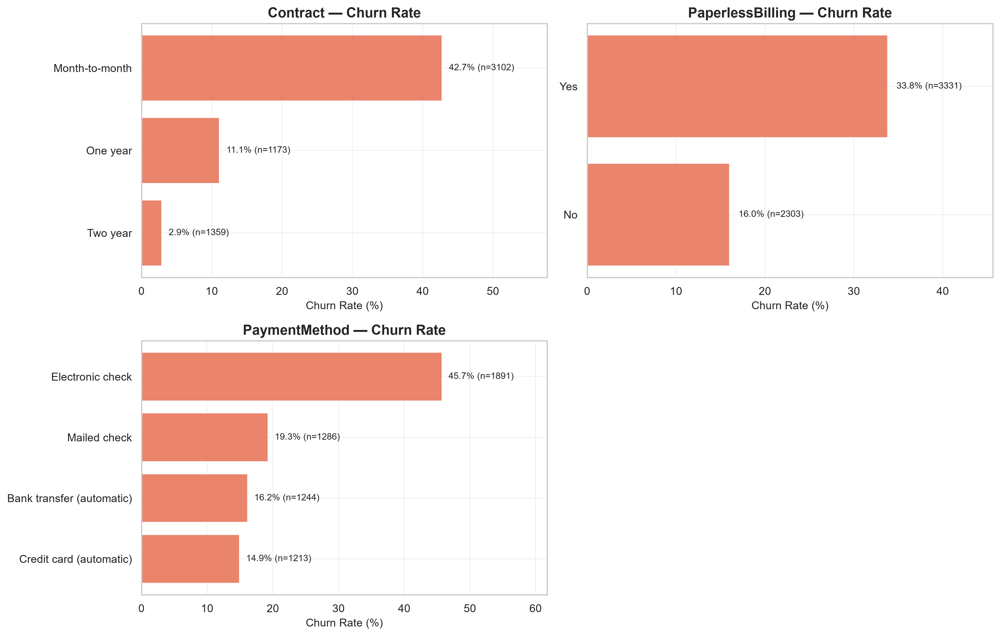
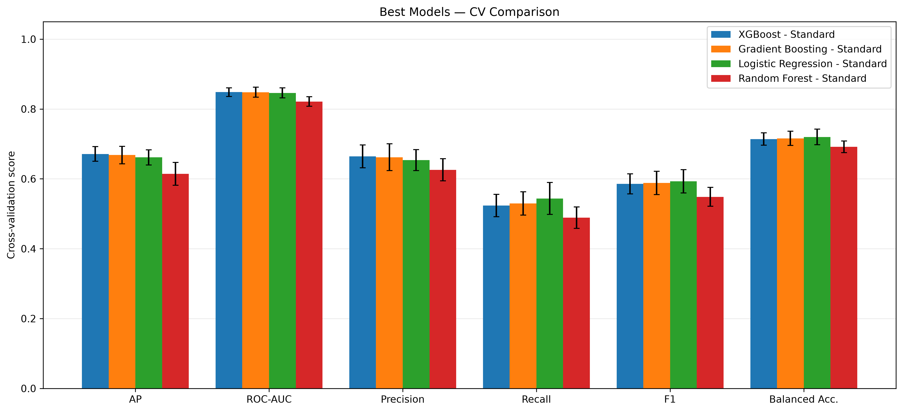
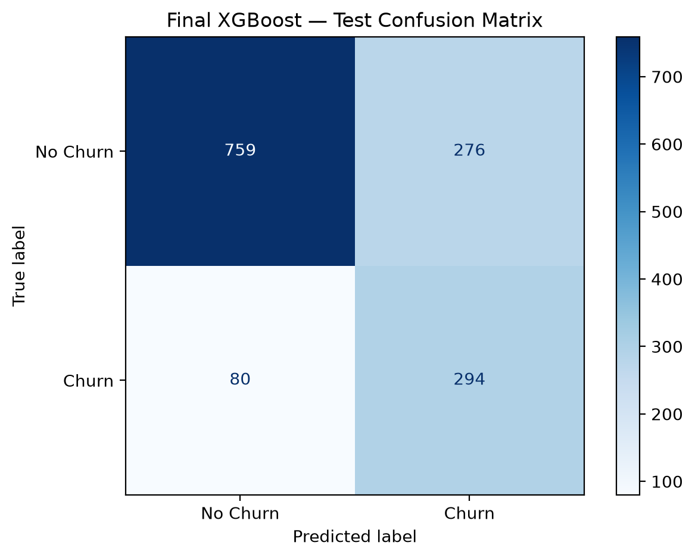
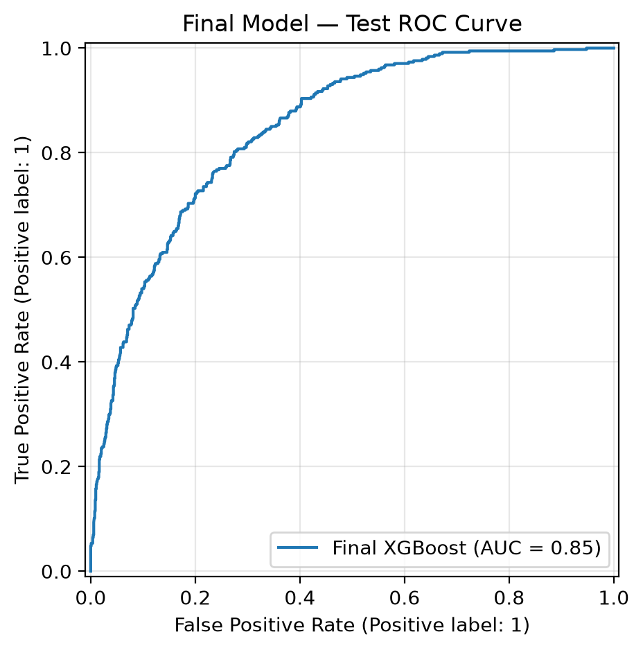
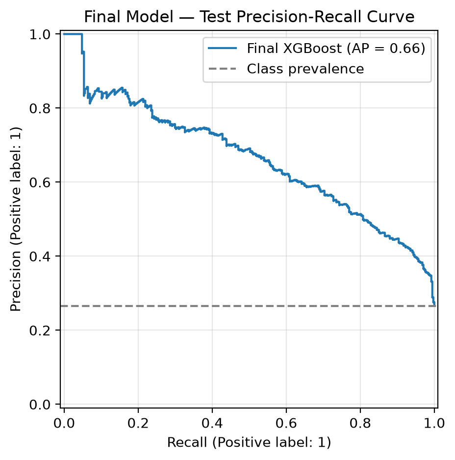
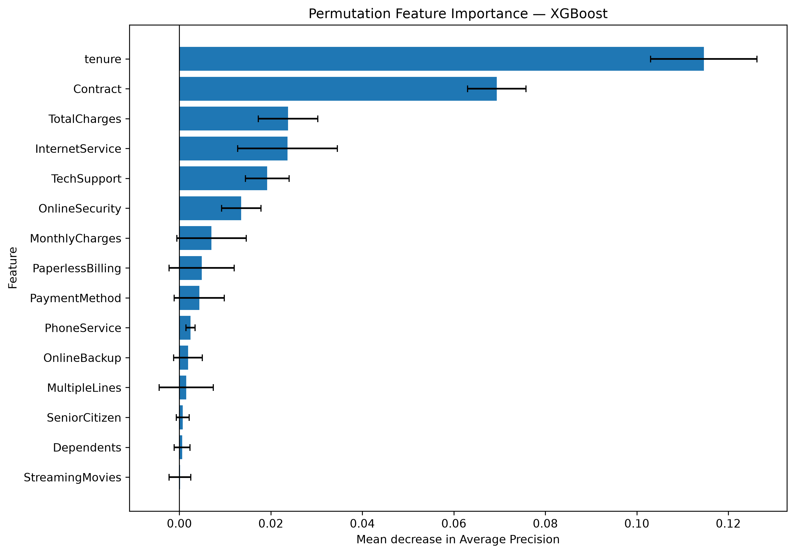
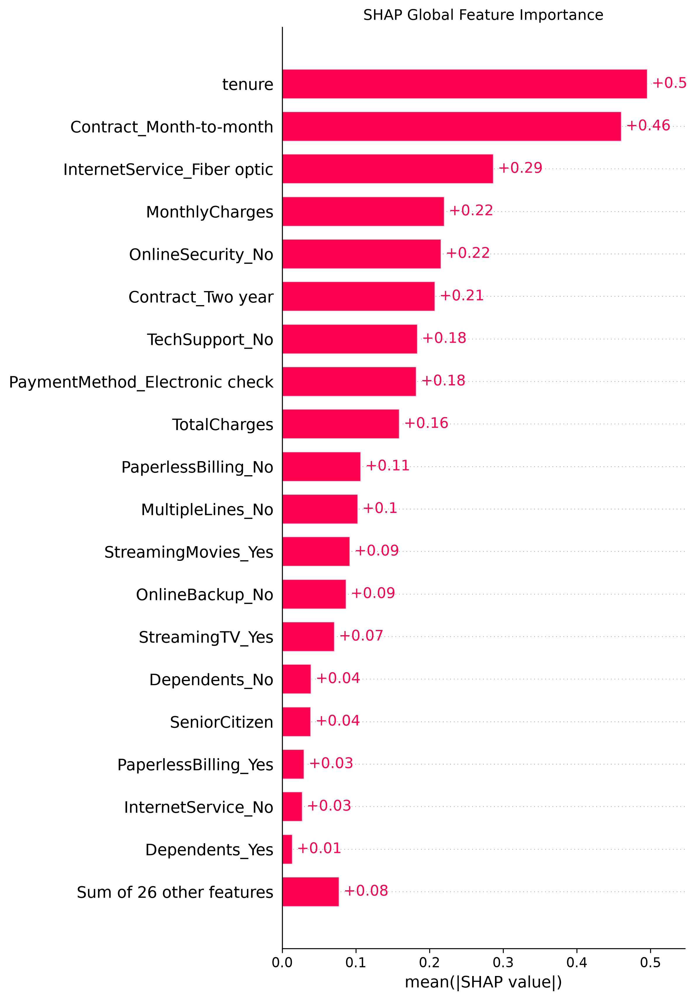

# Telco Customer Churn — End-to-End Machine Learning & MLOps

An end-to-end Machine Learning project designed to predict customer churn in the telecommunications industry, covering data validation, exploratory analysis, model optimization, explainable AI, API development, containerization, and automated cloud deployment.


## Live Demo

The application is deployed on Microsoft Azure Container Apps and publicly accessible.

| Service | Link |
|---|---|
| Interactive Gradio application | [Launch application](https://telco-churn-app.nicehill-20e3b8d0.francecentral.azurecontainerapps.io/gradio) |
| REST API documentation | [Swagger UI](https://telco-churn-app.nicehill-20e3b8d0.francecentral.azurecontainerapps.io/docs) |
| Health endpoint | [Health check](https://telco-churn-app.nicehill-20e3b8d0.francecentral.azurecontainerapps.io/health) |
| Model information | [Model metadata](https://telco-churn-app.nicehill-20e3b8d0.francecentral.azurecontainerapps.io/model-info) |

The application scales to zero when inactive. The first request may therefore experience a cold-start delay.

## 1. Business Problem

Customer churn represents a major challenge for telecommunications companies. Identifying customers who are likely to terminate their subscriptions enables businesses to implement targeted retention strategies.

This project aims to:

- Identify customers at high risk of churn.
- Estimate individual churn probabilities.
- Understand the main factors associated with customer attrition.
- Optimize the trade-off between precision and recall.
- Provide an accessible prediction service through a REST API and an interactive web application.
- Implement a reproducible and automated deployment pipeline.

## 2. Project Architecture



## 3. Dataset

The project uses the IBM Telco Customer Churn dataset.

| Characteristic | Value |
|---|---:|
| Original observations | 7,043 |
| Original columns | 21 |
| Target variable | Churn |
| Original churn rate | Approximately 26.5% |
| Input features | 19 |
| Transformed features | 45 |

The dataset includes demographic information, subscription details, internet and telephone services, billing information, and customer tenure.

### Data Quality

Data quality checks were implemented using Great Expectations, including:

- Customer identifier uniqueness.
- Missing-value detection.
- Categorical domain validation.
- Numerical range validation.
- Dataset schema validation.

Eleven invalid `TotalCharges` values associated with customers having zero tenure were identified during the audit.

## 4. Exploratory Data Analysis

Exploratory analysis was performed on the training data to avoid introducing information from the test set into model development.

Key findings include:

- Customers with month-to-month contracts exhibit higher churn rates.
- Customers with short tenure are particularly vulnerable to churn.
- Electronic check payment is associated with higher churn rates.
- Internet services, technical support, and online security are important factors associated with churn.

Categorical associations were investigated using Cramér's V, while numerical relationships were analyzed using Spearman correlation.





## 5. Machine Learning Methodology

### Preprocessing

Reusable Scikit-learn preprocessing pipelines were implemented to ensure consistent transformations during training and inference.

The preprocessing strategy includes:

- Numerical feature conversion.
- Missing-value handling.
- One-hot encoding of categorical variables.
- Standardization for linear models.
- Separate preprocessing configurations for linear and tree-based models.

Preprocessing and resampling operations were integrated into cross-validation pipelines to prevent data leakage.

### Model Benchmarking

Four model families were evaluated using stratified five-fold cross-validation:

- Logistic Regression
- Random Forest
- Gradient Boosting
- XGBoost

Multiple configurations were investigated, including standard training, class weighting, and random oversampling where applicable.

Average Precision was selected as the primary evaluation metric because of the imbalanced target distribution.



### Hyperparameter Optimization

Optuna was used to optimize the Gradient Boosting and XGBoost candidates.

MLflow was used to track experimental parameters and performance metrics.

| Optimized model | Mean CV Average Precision |
|---|---:|
| XGBoost | 0.6742 |
| Gradient Boosting | 0.6734 |

XGBoost was selected as the final model.

### Decision Threshold Optimization

The default classification threshold of 0.5 was replaced with an optimized threshold selected using out-of-fold predictions and F1-score maximization.

The final classification threshold is **0.287234**.

Threshold optimization was performed without using the held-out test set.

## 6. Final Model Performance

The final XGBoost pipeline was evaluated on a held-out test set containing 1,409 observations.

| Metric | Test result |
|---|---:|
| ROC-AUC | 0.8458 |
| Average Precision | 0.6646 |
| Precision | 0.5158 |
| Recall | 0.7861 |
| F1-score | 0.6229 |
| Balanced Accuracy | 0.7597 |

The model successfully identifies approximately 78.6% of actual churners.

### Confusion Matrix

| | Predicted Non-Churn | Predicted Churn |
|---|---:|---:|
| Actual Non-Churn | 759 | 276 |
| Actual Churn | 80 | 294 |



### ROC and Precision-Recall Curves





The selected threshold prioritizes the identification of potential churners while accepting a higher number of false-positive predictions.

In a real business environment, the operating threshold should be adapted to retention campaign costs and expected customer value.

## 7. Model Explainability

Model behavior was investigated using two complementary approaches:

- Permutation Importance
- SHAP (SHapley Additive exPlanations)

The most influential features include customer tenure, contract type, internet service, total charges, technical support, and online security.





Local SHAP explanations were also generated for true-positive, false-positive, true-negative, and false-negative predictions.

These explanations help understand individual predictions and identify potential limitations of the model. Feature importance should not be interpreted as evidence of causality.

## 8. Application Engineering

### FastAPI

The trained preprocessing and classification pipeline is serialized using Joblib and loaded by the prediction service.

The REST API provides the following endpoints:

| Method | Endpoint | Description |
|---|---|---|
| GET | `/health` | Application and model health |
| GET | `/model-info` | Model metadata and decision threshold |
| POST | `/predict` | Customer churn prediction |
| GET | `/docs` | Interactive API documentation |

Pydantic is used to validate incoming customer information.

### Gradio

An interactive Gradio interface allows users to submit customer profiles and obtain:

- Estimated churn probability.
- Classification threshold.
- Predicted churn class.

The interface uses the same prediction logic as the REST API.

### Automated Testing

The project includes 20 automated tests covering API functionality, input validation, prediction consistency, and Gradio functionality.

## 9. MLOps and Cloud Deployment

### Docker

The application is containerized using Docker.

Production dependencies are separated from development and experimentation dependencies to reduce unnecessary packages in the production environment.

The Docker image contains the inference application and the serialized production model.

### CI/CD Pipeline

GitHub Actions automates testing, image publication, and cloud deployment.


Docker images are tagged using the Git commit SHA, providing traceability between source code and deployed artifacts.

Pull requests trigger testing and Docker image building without publishing or deploying the image.

### Secure Authentication

GitHub Actions authenticates with Microsoft Azure using OpenID Connect (OIDC).

The security configuration includes:

- Microsoft Entra ID application identity.
- Federated credentials restricted to the repository and main branch.
- Role-Based Access Control scoped to the existing Container App.
- Short-lived authentication tokens instead of permanent client secrets.

### Azure Container Apps

| Configuration | Value |
|---|---|
| Region | France Central |
| Workload profile | Consumption |
| CPU | 0.5 vCPU |
| Memory | 1 GiB |
| Minimum replicas | 0 |
| Maximum replicas | 1 |
| Public access | HTTPS |

The application uses consumption-based hosting and scale-to-zero functionality to minimize infrastructure costs.

## 10. Technology Stack

| Category | Technologies |
|---|---|
| Programming | Python |
| Data processing | NumPy, Pandas |
| Data validation | Great Expectations |
| Visualization | Matplotlib, Seaborn |
| Machine Learning | Scikit-learn, XGBoost, Imbalanced-learn |
| Optimization | Optuna |
| Experiment tracking | MLflow |
| Explainable AI | SHAP, Permutation Importance |
| Model serialization | Joblib |
| API development | FastAPI, Pydantic, Uvicorn |
| Web interface | Gradio |
| Testing | Pytest |
| Containerization | Docker |
| CI/CD | GitHub Actions |
| Container registry | GitHub Container Registry |
| Cloud | Microsoft Azure Container Apps |
| Authentication | Microsoft Entra ID, OIDC, RBAC |

## 11. Repository Structure

```text
telco-customer-churn-ml/
├── .github/workflows/       # Automated CI/CD
├── app/                     # FastAPI and Gradio application
├── data/raw/                # Original dataset
├── figures/                 # Evaluation and interpretation figures
├── models/                  # Serialized production model
├── notebooks/               # Machine Learning experiments
├── reports/figures/         # EDA and benchmarking figures
├── results/                 # Experimental results and metrics
├── src/                     # Reusable Python modules
├── tests/                   # Automated tests
├── .dockerignore
├── .gitignore
├── Dockerfile
├── README.md
├── requirements.txt
└── requirements-prod.txt
```

## 12. Getting Started

### Clone the Repository

```bash
git clone https://github.com/MostafaH00/telco-customer-churn-ml.git
cd telco-customer-churn-ml
```

### Create a Virtual Environment

```bash
python -m venv .venv
```

Windows PowerShell:

```powershell
.venv\Scripts\Activate.ps1
```

Linux or macOS:

```bash
source .venv/bin/activate
```

### Install Dependencies

For development and Machine Learning experiments:

```bash
python -m pip install -r requirements.txt
```

For application inference only:

```bash
python -m pip install -r requirements-prod.txt
```

### Run the Application

```bash
python -m uvicorn app.main:app --host 0.0.0.0 --port 8000
```

Access the application locally:

- FastAPI: http://localhost:8000/docs
- Gradio: http://localhost:8000/gradio
- Health check: http://localhost:8000/health

### Run Automated Tests

```bash
python -m pytest -q tests/
```

### Run with Docker

```bash
docker build -t telco-churn:1.0 .
docker run --rm -p 8000:8000 telco-churn:1.0
```

## 13. API Prediction Example

Send a POST request to `/predict` with a customer profile:

```json
{
  "gender": "Female",
  "SeniorCitizen": 0,
  "Partner": "No",
  "Dependents": "No",
  "tenure": 1,
  "PhoneService": "Yes",
  "MultipleLines": "No",
  "InternetService": "Fiber optic",
  "OnlineSecurity": "No",
  "OnlineBackup": "No",
  "DeviceProtection": "No",
  "TechSupport": "No",
  "StreamingTV": "No",
  "StreamingMovies": "No",
  "Contract": "Month-to-month",
  "PaperlessBilling": "Yes",
  "PaymentMethod": "Electronic check",
  "MonthlyCharges": 76.45,
  "TotalCharges": 76.45
}
```

For this customer profile, the deployed model returns a churn probability of approximately 84.33%, resulting in a positive churn prediction.

## 14. Limitations and Future Improvements

- Evaluate the model on more recent and representative telecommunications datasets.
- Investigate probability calibration.
- Optimize classification thresholds using business-specific retention costs.
- Introduce automated data and model drift monitoring.
- Implement model version tracking and automated rollback.
- Extend deployment monitoring and historical logging.
- Investigate fairness across demographic groups.
- Introduce automated model retraining when new labeled data becomes available.

The current CI/CD pipeline automates application deployment, not model retraining.

## 15. Author

**Mostafa Harmoush**

Master's student in Computer Science — Data Science  
Université Claude Bernard Lyon 1, France

[GitHub Profile](https://github.com/MostafaH00)